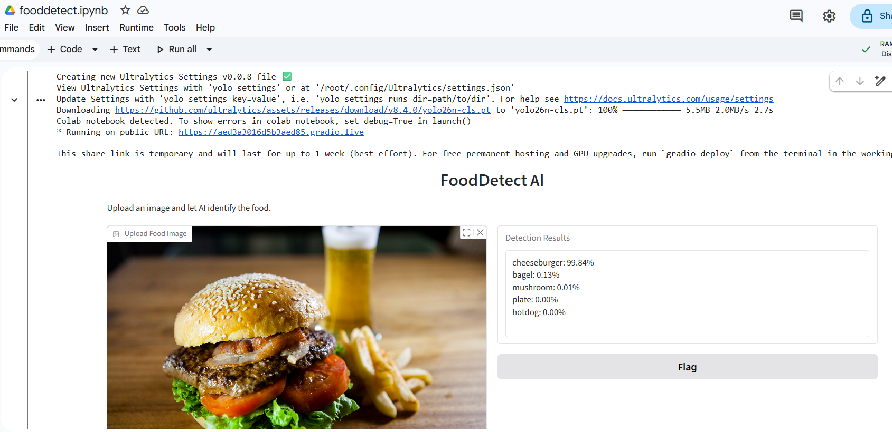

# FoodVision AI

FoodVision AI is a personal Computer Vision learning project exploring four food image analysis applications using Python and pretrained AI models. The goal is to demonstrate practical AI capabilities through simple applications, targeting approximately 30 lines of code (LOC) per application.

## Project Roadmap

The project consists of four planned applications:

| Application | Use Case | Computer Vision Task | Proposed AI Model | Status |
|---|---|---|---|---|
| **FoodDetect** | Identify food categories, e.g. burger or pizza | Image Classification | YOLO26n-cls | ✅ Completed |
| **FoodDescribe** | Describe visible food, e.g. burger with lettuce | Image Captioning | Salesforce BLIP | 🔜 Planned |
| **FoodCounter** | Locate and count food items in an image | Object Detection | YOLO26n | 🔜 Planned |
| **FoodHealth** | Identify food regions for composition analysis | Image Segmentation | YOLO26n-seg | 🔜 Planned |

## Current Progress

**As of 7 November 2026, only FoodDetect has been implemented.** The remaining three applications are planned as the next stages of this project.

One application down, three more to explore!

## FoodDetect – Image Classification

FoodDetect is the first working application. It uses the lightweight YOLO26n-cls pretrained model to classify uploaded images and return the top five predictions with confidence scores.

### Application Screenshot



### Try FoodDetect in Google Colab

[](https://colab.research.google.com/github/priandoyo/foodvision/blob/main/fooddetect.ipynb)

### How to Run

1. Open FoodDetect using the Google Colab link.
2. Select **File → Save a copy in Drive**.
3. Run the notebook.
4. Upload a food image.
5. Explore the AI classification results.

## Technology

- **Programming Language:** Python
- **Development Environment:** Google Colab
- **Web Interface:** Gradio
- **AI Framework:** Ultralytics and Hugging Face Transformers
- **AI Models:** YOLO, Salesforce BLIP, CLIP, and Vision Transformers (ViT)

## Learning Objectives

This project explores how pretrained AI models can be integrated into simple applications without training models from scratch. It also provides an opportunity to experiment with prompt engineering, Python programming, and practical Computer Vision concepts.

## Repository Structure

```text
foodvision/
├── README.md
├── fooddetect.ipynb
└── fooddetect.png
```

Additional notebooks and application screenshots will be added as the project develops.

**Project Status:** Work in Progress 🚧
